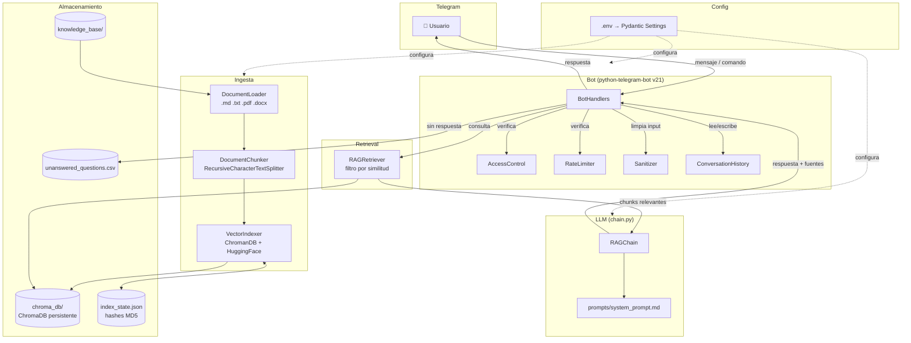

# Arquitectura del sistema

## Diagrama de componentes



---

## Flujo de ingesta

Desde que un archivo aparece en `knowledge_base/` hasta que queda indexado:

```
VectorIndexer.load_index_state()
└─ Lee index_state.json: { "archivo.pdf": { "md5": "...", "ts": "..." }, ... }

IngestionPipeline._select_files()
├─ Calcula MD5 de cada archivo actual en knowledge_base/
├─ Compara contra index_state.json
├─ → archivos nuevos/modificados: se procesan
└─ → archivos eliminados: se purgan del índice (RF-09)

VectorIndexer._delete_by_sources(deleted)
└─ Elimina de ChromaDB todos los chunks con metadata.source en deleted

Por cada archivo a procesar:
  DocumentLoader.load(file)
  ├─ .md / .txt  → TextLoader (UTF-8)
  ├─ .pdf        → PyPDFLoader (preserva número de página)
  └─ .docx       → Docx2txtLoader

  DocumentChunker.split(documents)
  ├─ RecursiveCharacterTextSplitter(chunk_size=800, chunk_overlap=100)
  │   Separa por \n\n, \n, " " antes de cortar por carácter
  └─ Agrega metadata: { source, page, chunk_index, file_type }

VectorIndexer.build_index(chunks, incremental=True)
├─ Elimina chunks anteriores del mismo source (si ya estaba indexado)
├─ Calcula embeddings con HuggingFaceEmbeddings (modelo local)
└─ Almacena en ChromaDB (persist_directory=chroma_db/)

VectorIndexer.save_index_state(state)
└─ Actualiza index_state.json con los MD5 de los archivos procesados
   (los archivos con error se excluyen para que reintenten en el próximo ciclo)
```

---

## Flujo de una pregunta

Desde que el usuario escribe en Telegram hasta que recibe la respuesta:

```
Telegram → BotHandlers.handle_message(update)

1. AccessControl.is_allowed(user_id)
   └─ O(1): busca en frozenset(ALLOWED_USER_IDS ∪ ADMIN_USER_IDS)
   → si no: reply "⛔ No tienes acceso"

2. RateLimiter.is_allowed(user_id)
   └─ Ventana deslizante 60 s, máx RATE_LIMIT_PER_MINUTE mensajes
   → si no: reply "⏳ Demasiados mensajes"

3. sanitize_input(raw_text)
   ├─ Trunca a 2000 caracteres
   └─ Detecta 7 patrones de inyección con regex (log warning)
   → si vacío: reply "Por favor envía un mensaje de texto"

4. RAGRetriever.retrieve(query)
   ├─ ChromaDB.similarity_search_with_relevance_scores(query, k=RETRIEVAL_TOP_K)
   └─ Filtra: descarta chunks con score < SIMILARITY_THRESHOLD (0.30)

5. ConversationHistory.get(user_id)
   └─ Últimos HISTORY_LENGTH turnos [{role, content}, ...]

6. RAGChain.run(query, chunks, history)
   │
   ├─ Si chunks == []:
   │   └─ Retorna _NO_INFO_MESSAGE sin llamar al LLM (RF-04)
   │
   └─ Si chunks > 0:
       Prompt final enviado al LLM:
       ┌────────────────────────────────────────────────────────┐
       │ [System]  contenido de prompts/system_prompt.md        │
       │ [Human]   turno 1 de historial                         │
       │ [AI]      turno 2 de historial                         │
       │ ...                                                    │
       │ [Human]   Responde basándote SOLO en el contexto:      │
       │           Contexto:                                    │
       │             [Fragmento 1] archivo.pdf (pág. 3): texto  │
       │             [Fragmento 2] politica.md: texto           │
       │           Pregunta: <query>                            │
       └────────────────────────────────────────────────────────┘
       └─ Llama al LLM configurado (OpenAI / Anthropic / Google)

7. Si chunks == []: _log_unanswered(uid_hash, query) → CSV (RF-10)

8. ConversationHistory.add(user_id, "user", query)
   ConversationHistory.add(user_id, "assistant", answer)

9. reply_text(answer + "\n\n📄 Fuentes: archivo.pdf (pág. 3), politica.md")
```

---

## Estructura de carpetas

```
mesa-ayuda-rag/
│
├── knowledge_base/          # Documentos fuente — editar aquí para actualizar el bot
│   ├── politica_vacaciones.md
│   ├── reembolso_gastos.txt
│   ├── politica_trabajo_remoto.md
│   ├── manual_soporte_ti.pdf
│   └── guia_bienvenida.pdf
│
├── prompts/
│   └── system_prompt.md     # Prompt de sistema — nunca hardcodeado en el código
│
├── specs/                   # Artefactos de Spec Driven Development (existieron antes que el código)
│   ├── spec.md              # Historias de usuario, requisitos y criterios de aceptación
│   ├── plan.md              # Arquitectura, componentes y tecnologías
│   └── tasks.md             # 38 tareas T-00..T-37 con estado
│
├── docs/                    # Documentación técnica
│   ├── ARQUITECTURA.md      # Este archivo
│   ├── DECISIONES.md        # 8 decisiones de arquitectura (ADR)
│   ├── USO_IA.md            # Transparencia sobre uso de IA
│   ├── EVALUACION.md        # Evaluación de calidad del RAG
│   └── CRITERIO_TECNICO.md  # Reflexión técnica y análisis de producción
│
├── src/
│   ├── config.py            # Pydantic Settings: carga .env, valida tipos, falla rápido
│   ├── logging_setup.py     # Logging JSON estructurado + HMAC-SHA256 de user_id
│   ├── main.py              # Punto de entrada: ingesta → LLM → bot → polling
│   │
│   ├── ingestion/
│   │   ├── loader.py        # Carga .md .txt .pdf .docx con metadatos
│   │   ├── chunker.py       # RecursiveCharacterTextSplitter + chunk_index
│   │   ├── indexer.py       # ChromaDB: load_or_create, build_index, get_indexed_sources
│   │   └── pipeline.py      # Orquestación incremental: selección, purga, indexación
│   │
│   ├── retrieval/
│   │   └── retriever.py     # Búsqueda semántica con filtro por SIMILARITY_THRESHOLD
│   │
│   ├── llm/
│   │   └── chain.py         # Factory multi-proveedor + RAGChain (prompt + LLM + fuentes)
│   │
│   ├── bot/
│   │   ├── handlers.py      # Comandos (/start /help /reset /fuentes /reindex) + handle_message
│   │   └── history.py       # ConversationHistory: deque por usuario
│   │
│   └── security/
│       ├── access.py        # AccessControl (frozenset) + RateLimiter (sliding window)
│       └── sanitizer.py     # Truncado + detección de 7 patrones de prompt injection
│
├── tests/
│   ├── test_config.py       # 13 casos: settings, validadores, parseo de listas
│   ├── test_chunker.py      # 9 casos: tamaño, solapamiento, metadatos, edge cases
│   ├── test_retriever.py    # 8 casos: threshold, top-k, formato de fuente
│   └── test_access.py       # 10 casos: acceso, admin, rate limit, ventana temporal
│
├── chroma_db/               # Índice vectorial generado (en .gitignore)
├── index_state.json         # Estado de indexación incremental (en .gitignore)
├── unanswered_questions.csv # Preguntas sin respuesta (en .gitignore)
│
├── .env                     # Secretos y configuración local (en .gitignore — nunca subir)
├── .env.example             # Plantilla documentada con todas las variables
├── .gitignore
├── pyproject.toml           # Dependencias, ruff, pytest
└── README.md
```
